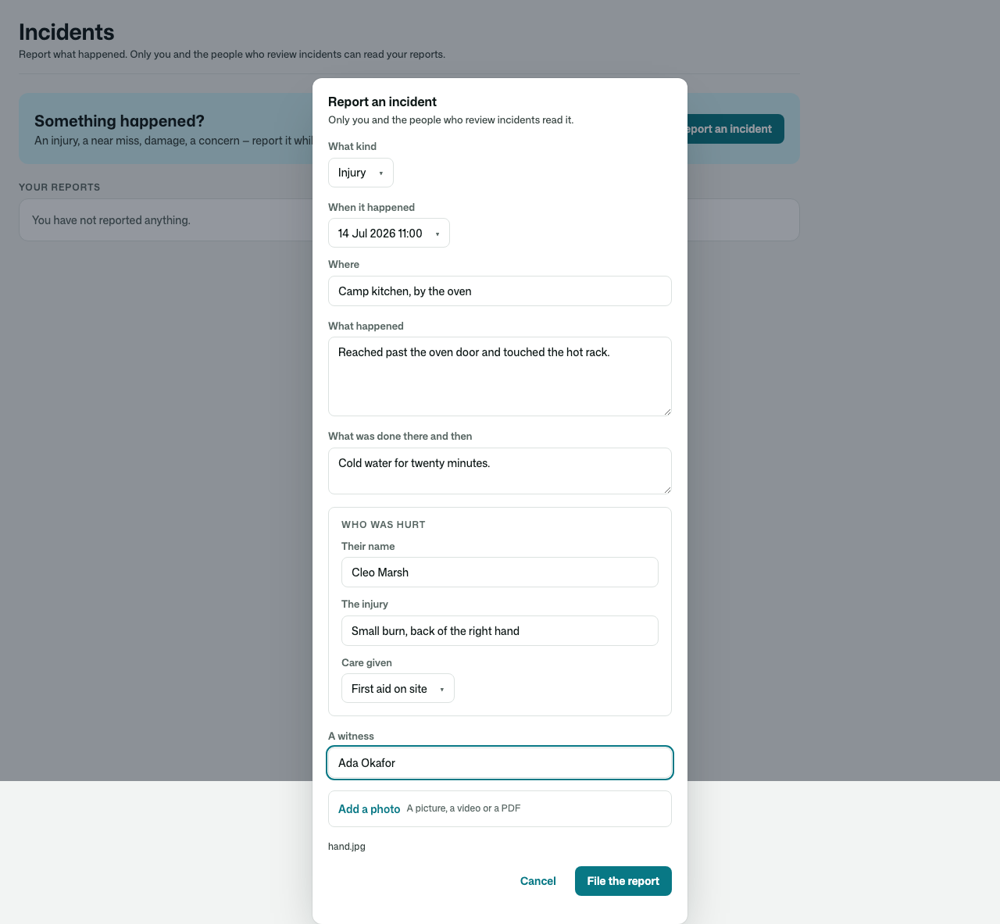
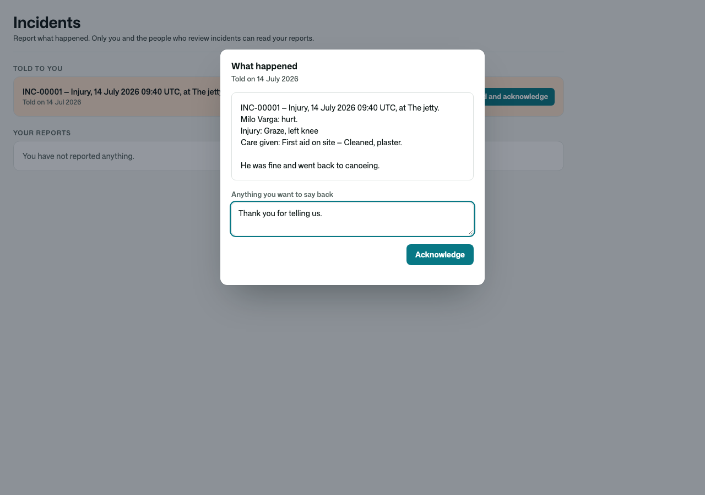
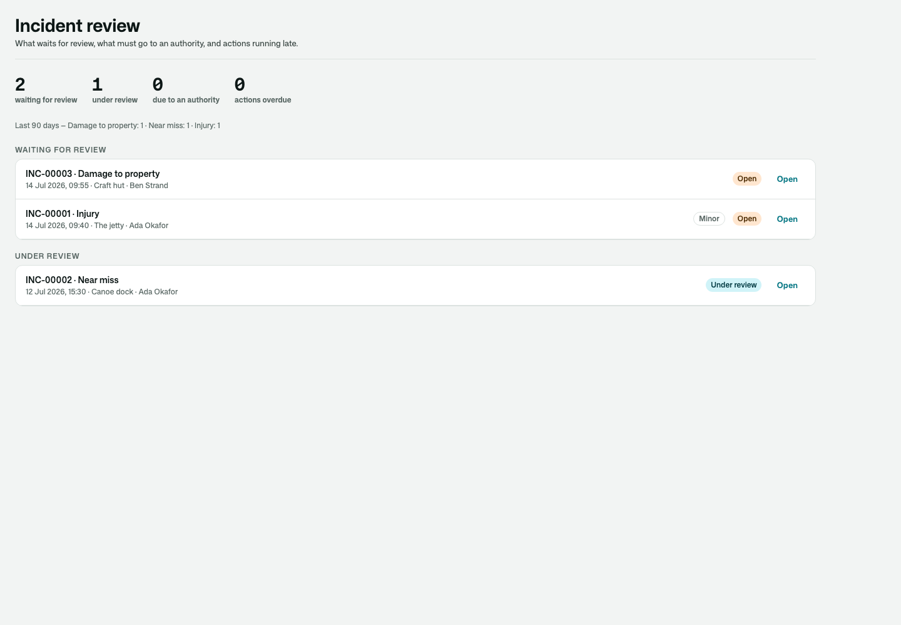
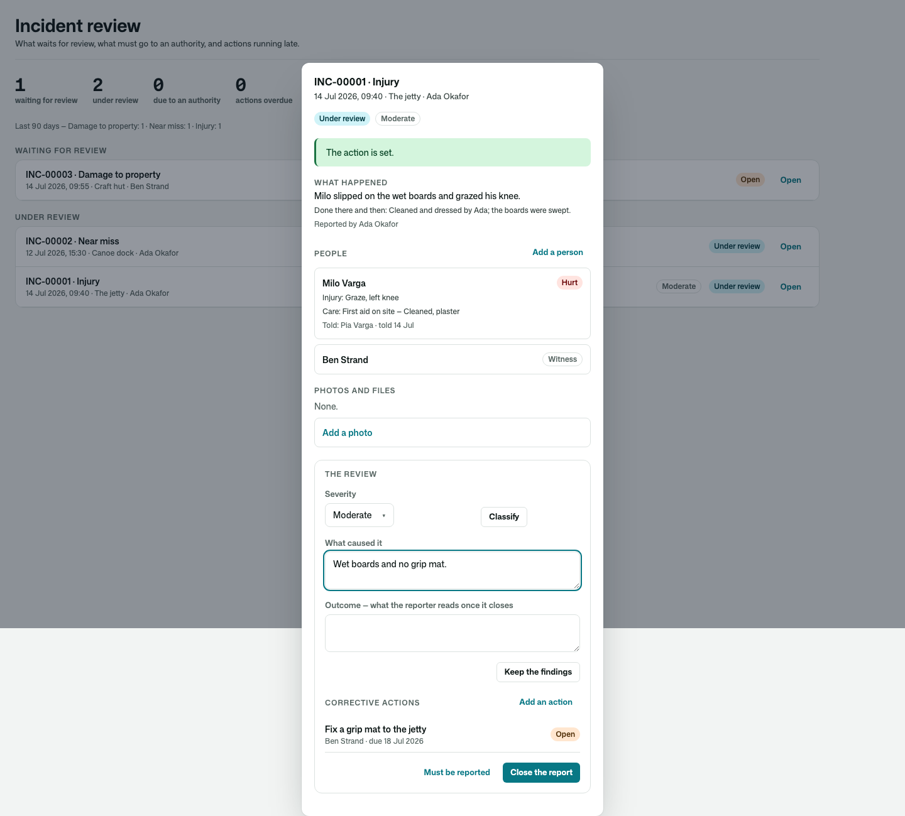
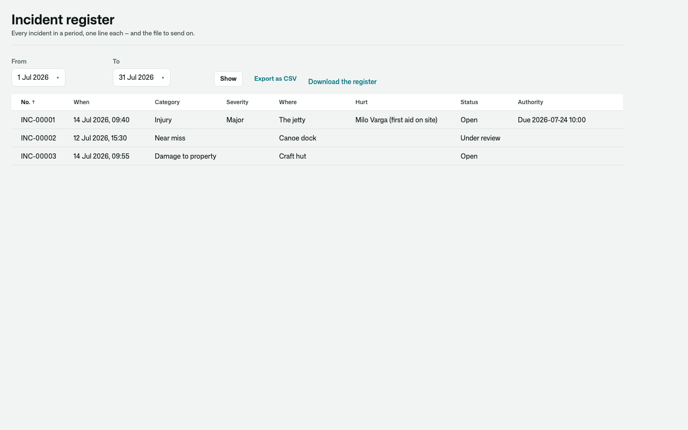
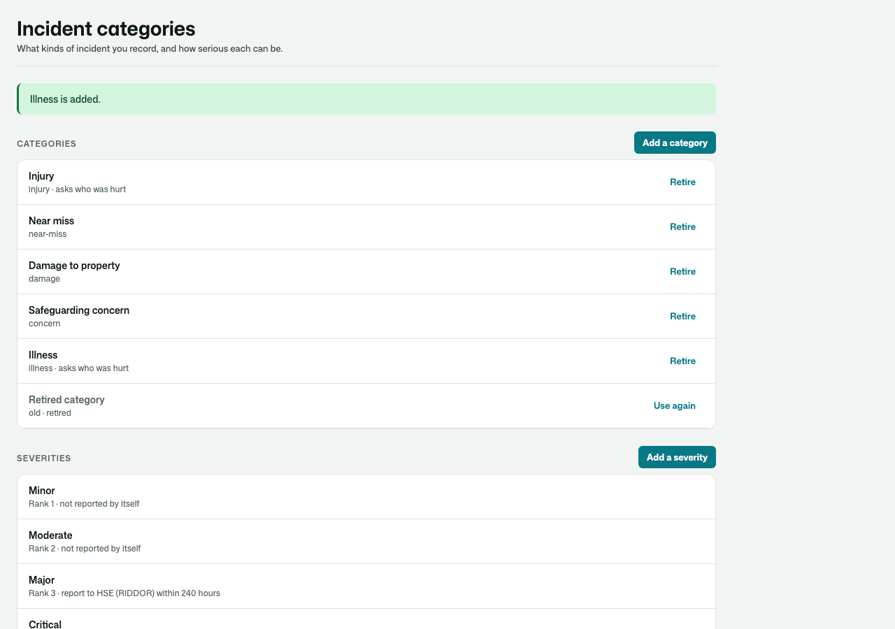
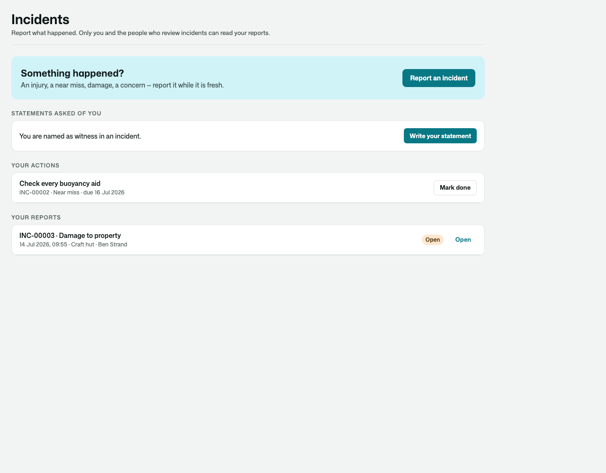
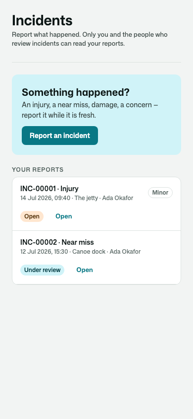
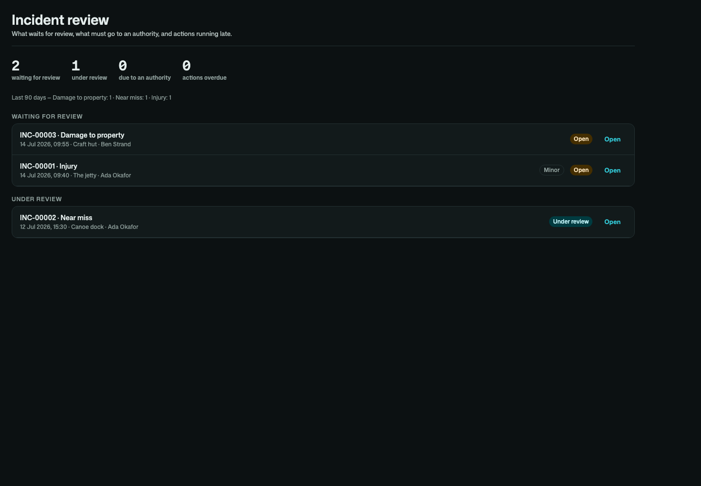

# Osysharp.IncidentReports

**Confidential incident reports, from the moment something happens to the day it is closed.** An injury, a near miss,
damage, a safeguarding concern — for a camp, a school, a club, a venue, a workshop, a care home, a building site.

- **Reported while it is fresh** — what kind (categories you define), when and where, what happened, what was done
  there and then, who was hurt, a witness, photos and files. The person who reported it corrects it until review starts.
- **Confidential by declaration** — a report is read by the person who filed it and by whoever reviews incidents.
  Nobody else, in lists, counts and searches alike. Internal notes and the cause stay with the reviewers.
- **People involved** — hurt, involved or a witness, with an account (a member of staff, a member, or a child or
  visitor with an account they never sign in to) or just a name. Each has their injury, the care given (first aid, sent
  home, doctor, hospital, ambulance), days away, and **their own statement**, which a witness can write themselves.
- **A review** that classifies the report by **severity** (yours, ranked), records the cause and the outcome, and
  sets **corrective actions** with an owner and a due date. The owner reads their action, never the report, and marks
  it done. The app is told once when an action runs late. A report does not close while an action is open.
- **The people who must be told** — a child's parents, a client's carer — are offered on the desk and told in one
  click. They read exactly what they were told and **acknowledge** it. The app says who they are (`IIncidentContacts`);
  with Osysharp.Guardianship it is a child's guardians, by itself.
- **Reporting to an authority** — a severity can carry a deadline ("report within 240 hours, to HSE"), or a
  reviewer sets one. A durable clock warns before it and says when it has passed. The authority's reference is kept,
  and the report cannot close until it is recorded.
- **A register** of every incident in a period, one line each, the way an accident book or an injury log reads, and
  its **CSV**.
- **Nothing is deleted.** A closed report can be re-opened, with the reason kept.

| Reporting an incident | Somebody hurt, told about it |
|---|---|
|  |  |

| The review desk | One report under review |
|---|---|
|  |  |

| The register | Categories and severities |
|---|---|
|  |  |

| Your side: statements and actions | On a phone · in the dark |
|---|---|
|  |   |

## Use it

```osy
// app.osy
use Osysharp.Identity@0;
use Osysharp.IncidentReports@0;
use Osysharp.Storage;
```

```osy
using Osysharp.Identity;
using Osysharp.IncidentReports;

policy ReviewsIncidents => IsSafetyLead;     // reads every report, reviews, assigns actions, tells people, the register
policy ReportsIncidents => IsStaff;          // who files a report (anybody signed in, unless you narrow it)
policy ManagesIncidentSetup => IsAdmin;      // the categories and severities (whoever reviews, unless you narrow it)

app.Incidents = new IncidentsSetup { AuthorityWarningHours = 24, Organisation = "Pine Lake Day Camp" };

// Who must be told about somebody named in a report — found by the kit, never wired:
public class NextOfKin : IIncidentContacts {
  public List<Principal> ContactsFor(Principal person) => EmergencyContact.Where(c => c.Of == person).Select(c => c.Contact).ToList();
}

[On] void TellTheLead(IncidentReported e) { /* mail whoever reviews */ }
[On] void Chase(CorrectiveActionOverdue e) { /* remind e.Action.Owner */ }
```

From code: `ReportIncident`, `AddIncidentPerson`, `GiveStatement`, `KeepIncidentFile`, `AttachIncidentFile`,
`StartIncidentReview`, `ClassifyIncident`, `RecordIncidentFindings`, `MarkIncidentReportable`, `RecordAuthorityReport`,
`CloseIncident`, `ReopenIncident`, `AssignCorrectiveAction`, `CompleteCorrectiveAction`, `CancelCorrectiveAction`,
`ContactsToInform`, `InformAboutIncident`, `InformContacts`, `AcknowledgeIncidentNotice`, `MyIncidents`,
`OpenIncidents`, `AwaitingAuthorityReport`, `OverdueActions`, `IncidentRegister`, `IncidentRegisterCsv`. Events:
`IncidentReported`, `IncidentReviewStarted`, `IncidentClosed`, `IncidentReopened`, `IncidentReportable`,
`IncidentAuthorityReportDue`, `IncidentAuthorityReportOverdue`, `CorrectiveActionAssigned`,
`CorrectiveActionCompleted`, `CorrectiveActionOverdue`, `IncidentNoticeSent`, `IncidentNoticeAcknowledged`.

## Pages

`/incidents` (report one; your reports, actions, statements and what you were told), `/staff/incidents` (the review
desk), `/staff/incidents/register` and `/staff/incidents/setup` are served in the app's working shell, in its theme.
Take one over by declaring a component of the same name, or place `MyIncidents`, `ReportIncidentForm`,
`IncidentsDesk`, `IncidentDetail`, `IncidentRegisterView` or `IncidentSetup` on a page of your own.

## Personal data

What happened and a statement are personal content, the names of those involved identity, and an injury and the care
given **health data** (special category). In an app with Osysharp.Privacy, Osysharp.Privacy.IncidentReports arrives by
itself: the reports a person filed, the lines naming them and what they were told are in their copy of their data, kept
on the legal obligation incident records carry, and erased from the record when that ends.

## What informed it

- **SafetyCulture (iAuditor) and Vector EHS** — witness statements, photos and evidence on the report, a severity, an
  investigation with root cause, and corrective actions with an owner and a due date.
- **RIDDOR and OSHA's severe-injury reporting** — an incident that must go to an authority within a set time (10 or 15
  days for RIDDOR, 8 or 24 hours for OSHA), the authority's reference kept; days away from work counted as an injury
  log counts them.
- **Childcare and school incident reports (Procare, licensing forms)** — the parent told the same day, and their
  acknowledgement kept with the report.

## Source

[github.com/osysharp/incidentreports](https://github.com/osysharp/incidentreports). Its tests (`tests/`) are a summer day
camp's: every behaviour above, each seam shown, the rules proved as each person, and the pages under `osy test --pixels`.
